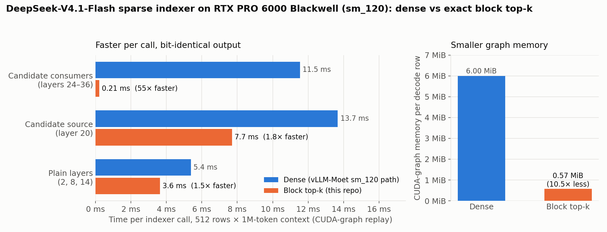

# sm120-block-topk

**Exact block top-k for DeepSeek-V4.1-Flash's sparse indexer on RTX PRO 6000 Blackwell (sm_120).**
Each indexer call returns the same top-k rows as vLLM's dense sm_120 path, bit for bit. It cuts the indexer's
CUDA-graph memory **10.5×** (6.0 → 0.57 MiB per decode row), freeing about 2.5 GiB per GPU at 1M context. At 1M-token context the layers that reuse candidate blocks run **up to 55× faster**, the others 1.5–1.8×.



## The problem

DeepSeek-V4.1-Flash picks the tokens each query attends to with a lightning indexer: eight indexer layers score every
cached token and keep the top 512. On sm_120, vLLM's dense path materialises fp32 logits over the whole
`max_model_len` for every query row: 2–4 MiB per row and layer at a 1M context, **6.0 MiB per row** across a decode
step's eight indexer calls. Inside CUDA graphs that memory is reserved for every captured row, so at 512 graph rows it
costs about 3 GiB per GPU. That memory is then not available for KV cache.

## What this does

Each layer scores every token once but **keeps only the maximum of each 8-token block**. It selects the top blocks,
rescores only those blocks' tokens, and takes the top 512 from them. The candidate-consumer layers (24–36) skip the
full scan entirely and score only their 2,048 candidate blocks.

**Why it is exact.** Order tokens by (logit desc, column asc) and blocks by (max logit desc, block asc). If a top-k
token sat in a block outside the top-k blocks, each of those k blocks would contain a token ranked above it. That would
put k tokens ahead of it, so it could not be in the top k. Therefore the top k tokens always lie inside the top k
blocks. The scan reproduces the dense kernel's fp32 value bit for bit (same MMA, same epilogue order), and ties
resolve the same way. The full argument, including the two edge cases with NaN/inf logits, is in
[NOTES.md §2.2](NOTES.md).

**Checked:** 261 cases, all identical to the dense path (top-k rows and candidate blocks):
- contexts 4k–1M with 1–512 rows;
- every threshold;
- mixed batches;
- ties;
- inf/NaN logits;
- prefill chunks.

vLLM's own `SparseAttnIndexer` op gives identical buffers with the switch on and off. The logs are in
[`results/`](results/).

## Numbers

**Per indexer call** (CUDA-graph replay, one RTX PRO 6000, dense → block, µs; full table in [NOTES.md §2.4](NOTES.md)):

| layer | context | 8 rows | 128 rows | 512 rows |
|---|---|---|---|---|
| 20 (candidate source) | 1M | 197 → 142 | 3,440 → 1,781 | 13,672 → 7,706 |
| 2 / 8 / 14 (ratio 2) | 1M | 95 → 83 | 1,465 → 911 | 5,385 → 3,640 |
| 24–36 (candidate consumers) | 1M | 192 → 24 | 2,924 → 65 | 11,538 → 210 |
| 24–36 (candidate consumers) | 64k | 28 → 26 | 175 → 67 | 709 → 208 |

At short contexts with small batches the block path is a few µs slower (five graph nodes against two). When K
outgrows the 128 MiB L2 (64 requests × 1M tokens), the dense logits kernel is DRAM-bound at 1.4 TB/s. The grouped scan
reads each request's K once, so a whole 512-row call takes 32.7 → 8.1 ms for layer 20.

**In the engine** (DeepSeek-V4.1-Flash, vLLM-Moet `64096a4`):
- **Graph memory:** the indexer's share falls from 6.000 to 0.570 MiB per captured row.
- **Quality:** GSM8K-200 196–197/200, the same as dense. Needle retrieval passes at 827k tokens.
- **Fallbacks:** 0 dense fallbacks under load.
- **Short-context decode throughput:** unchanged (±3%). The gain is memory, not speed.

## Use it

You need four things:
- sm_120 GPUs;
- a [vLLM-Moet](https://github.com/kacper-daftcode/vLLM-Moet) DeepSeek-V4.1-Flash image built at commit `64096a4`;
- `indexer_kv_dtype=mxfp4`;
- `VLLM_MOET_DET_TOPK=1 VLLM_MOET_CANDIDATE_DET_TOPK=1`. Block top-k reproduces those deterministic selections, and
  without them it stays dense.

**Option A: image.** Pull the prebuilt image (vLLM-Moet `64096a4` + this switch):

```bash
docker pull ghcr.io/goedelmachines/vllm-moet-sm120:dsv41-64096a4-blocktopk
```

Or build it on top of your vLLM-Moet image (no GPU needed; it compiles the extension for sm_120a):

```bash
docker build --build-arg BASE=vllm-moet-sm120:dsv41-64096a4 -t vllm-moet-sm120:dsv41-64096a4-blocktopk .
```

Then run that image exactly as you run vLLM-Moet. The image sets `VLLM_MOET_INDEXER_BLOCK_TOPK=1`.

**Option B: mounts.** Keep your image and add:

```bash
EXTRA_DOCKER_ARGS="$(patch/mount_args_block_topk.sh)"
# = -v <repo>/patch/patched/.../sparse_attn_indexer.py:<vllm>/.../sparse_attn_indexer.py:ro
#   -v <repo>:/opt/vllm-moet/sm120_sparse_indexer:ro  -e VLLM_MOET_INDEXER_BLOCK_TOPK=1
```

Each worker's log should show `vllm-moet: indexer block top-k from ... (decode rows; prefill chunks dense)`. A line
saying `does not take this decode layout` means some calls fell back to the dense path.

**Run the checks** (one GPU, ~12 min): `GPU=0 ./run_all.sh`. The logs go to `results/`.

## Limits

- **GPU count.** The kernels run inside each GPU and never communicate, so the setup should not matter: the saving is
  per GPU (about 5.4 MiB per captured decode row at 1M context). Engine-tested only with tensor parallel over 4 GPUs;
  TP2/TP8, data/expert parallel and RTX 5090 (also sm_120) are untested. Reports welcome.
- **Decode only by default.** Prefill chunks stay dense: in the engine, block-path prefill was 12–26% slower for
  reasons not yet found. Module benches show it faster from 131k context up. Add it with
  `VLLM_MOET_INDEXER_BLOCK_TOPK_PREFILL=1`.
- **Falls back to the dense path** (still correct) for: FP8 indexer cache, native `next_n > 1` rows, DCP/PCP, or
  `candidate_block_size != 8`.
- **Built against vLLM-Moet `64096a4`.** The patched `sparse_attn_indexer.py` is a full copy of that image's file.
  For another image, regenerate it with `python3 patch/patch_vllm_indexer_block_topk_sm120.py <vllm tree>`.
- The 0.5 MiB/row of block maxima that remain scale with `max_model_len`. A two-level (64-token) selection would cut
  it to ~0.13 MiB.

Section 1 of [NOTES.md](NOTES.md) also has an sm_120 implementation of DeepGEMM's sparse MQA-logits API. It is
exact too, but saves no graph memory on its own, so it is not what we serve.

## License

Apache-2.0. `patch/patched/` contains modified vLLM / vLLM-Moet files; see [NOTICE](NOTICE).
Built by [Goedel Machines](https://goedelmachines.com).
